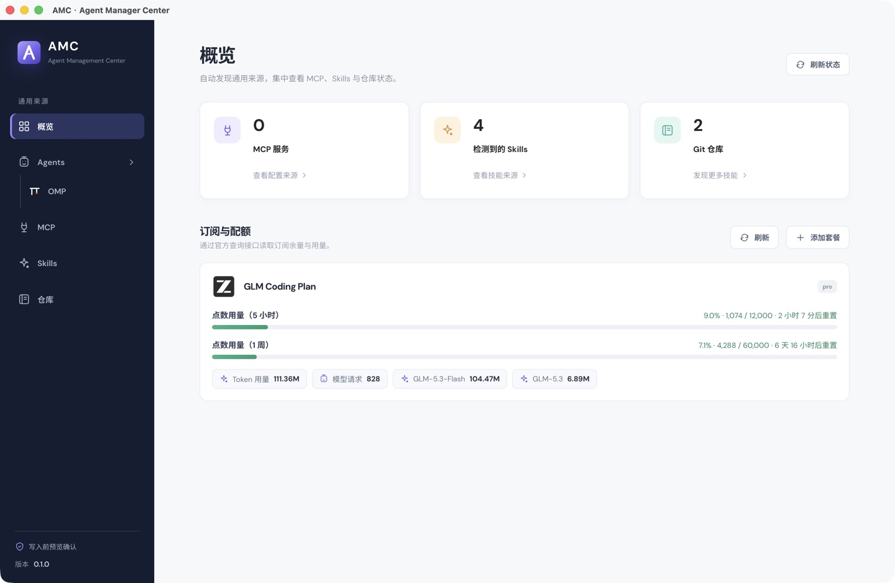
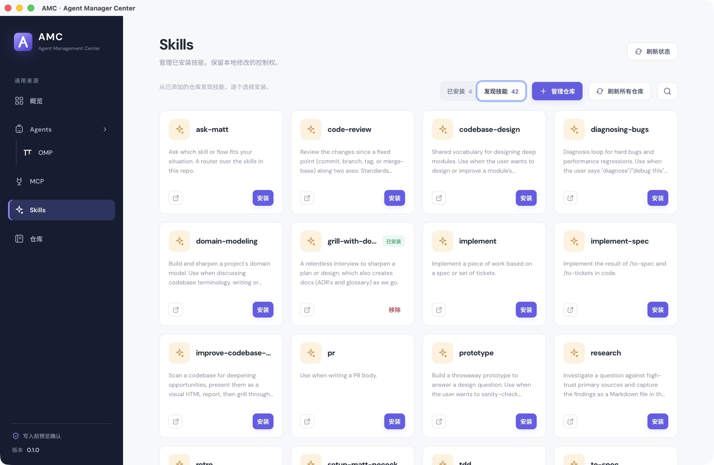
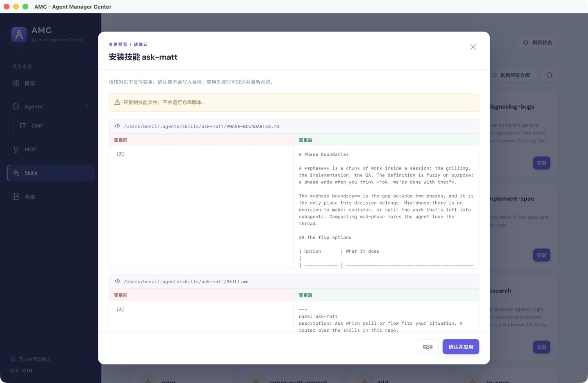
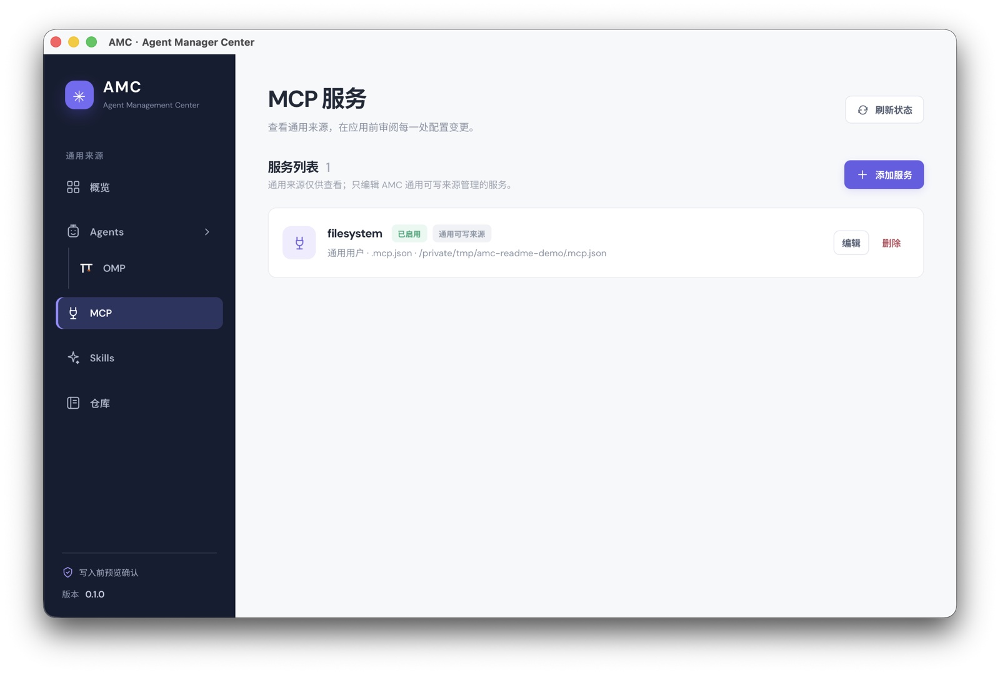

# AMC · Agent Manager Center

AMC 是 macOS 桌面端的 Agent 管理工具：在一个界面里统一配置 MCP、分发 Skills、归档三家 Agent 的用量统计、查看订阅配额。支持 OMP、Claude Code 与 Codex CLI，所有数据都保存在本机。

## 安装

**系统要求**：macOS（Apple Silicon 与 Intel 均提供安装包）。被管理的 Agent 按需安装即可，AMC 会自动检测本机已有的运行时，未安装的 Agent 不影响其他功能。

从 [GitHub Releases](https://github.com/BenZinaDaze/amc/releases) 下载 DMG 并安装。

目前 DMG 未做 Apple 公证。将 AMC.app 复制到 `/Applications` 后，若 macOS 阻止打开，仅在确认下载来源可信时运行以下命令。它会递归清除应用的扩展属性（包括下载隔离标记），不会为应用签名：

```sh
xattr -cr /Applications/AMC.app
```

然后重新打开 AMC。应用内置自动更新：启动后检查新版本，可在应用内下载安装并重启，更新包经签名校验后才安装。

## 主要功能

### 用量统计（Agents 页）

- 自动检测本机 OMP、Claude Code 与 Codex CLI 的安装状态与版本；有新版本时，点击即可调用 Agent 自带的更新命令完成更新，并在更新前后核对实际版本。
- 汇总三家的请求数、Token 用量与费用，可按模型查看明细，按时间范围（近 1 小时到全部，支持自定义区间）查看趋势。
- 统计读取 Agent 在本机留下的会话数据后归档到 AMC 自己的数据库：之后即使 Agent 清理了历史文件，统计依然可查；费用按当前计价表即时重算，没有计价的模型会明确标出。

### 订阅与配额（概览页）

以卡片展示各订阅的套餐与用量，支持单独刷新：

- **GLM Coding Plan**：窗口配额与本周用量，按模型分项。
- **Sub2API**：订阅计划的窗口用量、钱包余额或限额 Key 的速率窗口，附请求数与 Token 汇总。
- **Google Antigravity**（Google One AI Pro / Ultra）：浏览器登录 Google 账号即可（无需安装 Antigravity），展示 Gemini 与非 Gemini 两个池的 5 小时/每周窗口余量、重置倒计时与套餐层级。
- **DeepSeek API**：按币种的账户余额与可用状态。
- **Cursor**（Pro / Pro+ / Ultra）：浏览器授权登录，展示使用比例与账期重置倒计时；登录凭据约两个月有效，过期后删除卡片重新登录即可。

### Skills 分发

- 添加远程 Git 仓库或本地目录作为来源，浏览其中的技能，勾选安装。
- 技能集中保存在 AMC 的中央副本，按需投影到各 Agent 的技能目录（`~/.agents/skills` 与 `~/.claude/skills`）；每个技能可对 OMP / Codex / Claude Code 单独启停。
- 一切写入都有变更预览：先审阅差异，再确认应用。AMC 只触碰自己创建的投影——你在技能目录里的自有内容，哪怕与技能同名同内容，也不会被覆盖或删除。
- 分发条目可从仓库更新到新版本，或整体移除。

### MCP 管理

- 在一个列表里定义所有 MCP 服务，按需勾选同步到 OMP、Claude Code 或 Codex 的用户级配置；Agent 未安装时只记录选择，不创建文件。
- 每次写入前生成文件级变更预览，确认后原子替换并自动备份。
- AMC 只管理通过它保存的服务，不读取、不合并 Agent 配置文件里已有的内容；密钥在界面与预览中始终脱敏显示。

### 其他

- **仓库页**：管理 Skills 的来源（远程 Git 仓库 / 本地目录）。
- **设置页**：查看 AMC 管理的用户级配置位置与应用信息。

## 数据与隐私

- **无服务端**：所有记录、凭据与统计都保存在本机应用数据目录，不向任何服务器上传；订阅凭据以最小文件权限（0600）存储。
- **先预览后写入**：所有对用户级配置的写入都遵循「预览 → 确认 → 应用」；应用时若发现文件内容与预览时不一致，会自动中止并提示重新预览。
- **原子写入**：配置文件一律以「写临时文件再替换」的方式落盘，中断不会留下写了一半的文件。

> 注意：部分订阅的额度查询使用服务方未公开的内部接口，字段形状可能随版本变化；解析失败时对应卡片降级展示，不影响其他卡片，AMC 不会臆造数值。

## 界面预览

概览



Skills 发现与选择安装



安装前的变更预览



MCP 服务管理


